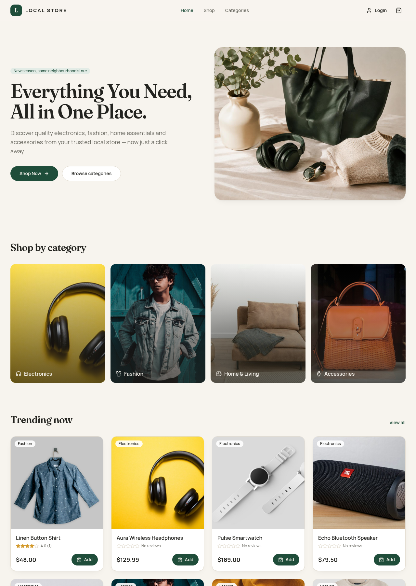
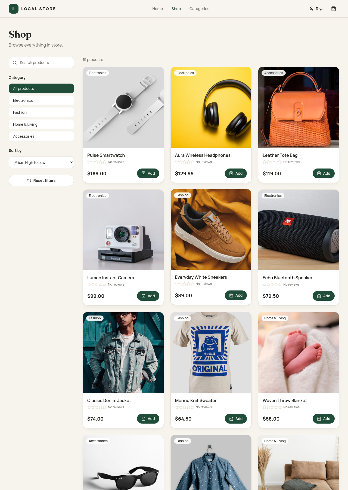
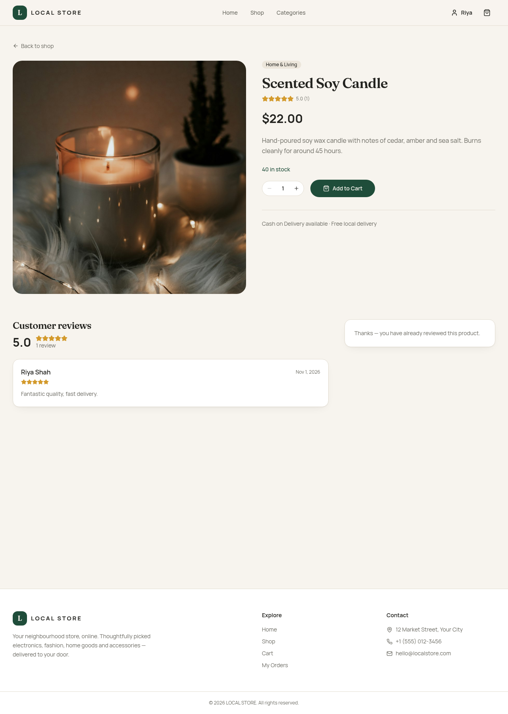
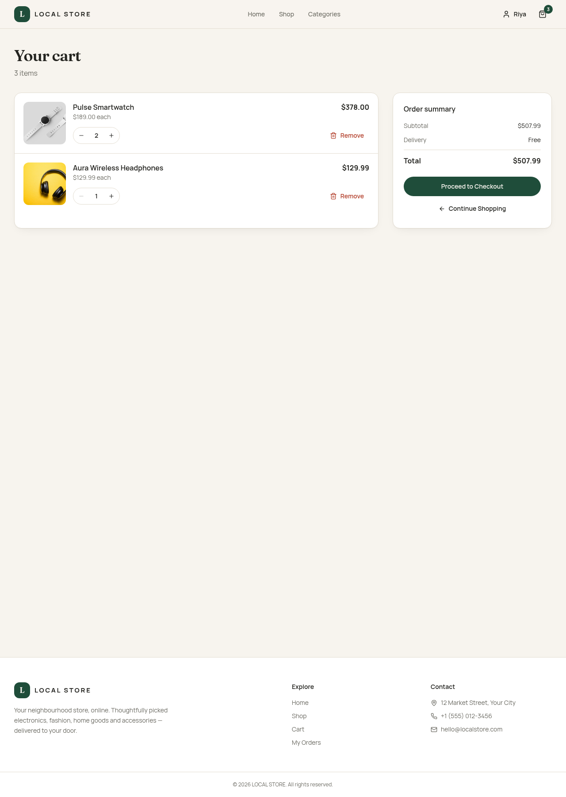
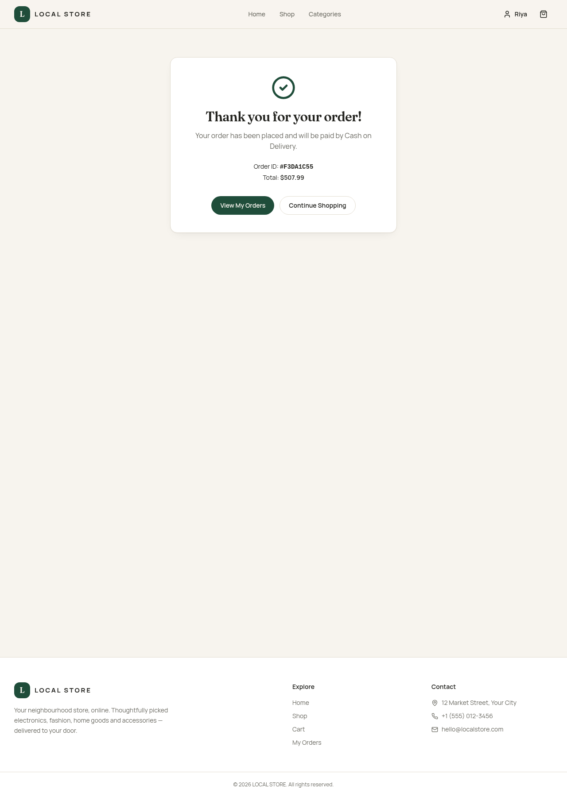
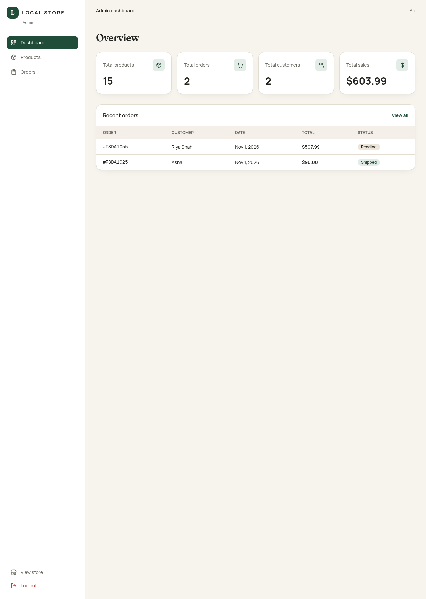

# LOCAL STORE – Full-Stack E-Commerce App (MERN)

A complete online store for a local retail shop, built for **Prodigy Infotech – Task 03 (Full Stack Development)**.

Customers can browse a catalogue of **27 products**, search and filter, read and write reviews, manage a cart and place **Cash on Delivery** orders. Admins get a dashboard to manage products, stock and orders.



---

## Repository layout

```text
e-commerce-app/
└── mern/
    ├── backend/        Express REST API, Mongoose models, JWT auth, seed script
    ├── frontend/       React 18 + Vite + Tailwind CSS + React Router + Axios
    └── screenshots/    Screenshots of the running app
```

The whole project lives in `mern/`: the Express + MongoDB API in `mern/backend`, the React site in `mern/frontend`. A step-by-step guide is in [`mern/README.md`](mern/README.md).

---

## Features

**Customer**
- Home page with hero, categories, trending products and promo banner
- Shop page with live search, category filter, price sort and reset
- Product details with stock, quantity selector, ratings and reviews
- Cart with quantity controls, totals and item-count badge
- Checkout with validated shipping form and Cash on Delivery
- Order confirmation and **My Orders** history with status
- Register / Login / Logout (JWT), protected routes, profile page

**Admin**
- Dashboard stats: products, orders, customers, total sales
- Add, edit, delete products and update stock
- View all orders and change status (Pending → Processing → Shipped → Delivered / Cancelled)
- Placing an order reduces stock; cancelling returns it

**Optional features**
1. Backend product sorting & filtering via query parameters
2. Product reviews & ratings (one review per user per product, average updates automatically)

---

## Tech stack

| Layer | Technology |
| --- | --- |
| Frontend | React 18, Vite, Tailwind CSS v4, React Router DOM, Axios, Context API, Lucide icons |
| Backend | Node.js, Express.js, MongoDB, Mongoose, JWT, bcryptjs |

---

## Running the project

**Requirements:** Node.js 18+ and MongoDB (local or MongoDB Atlas).

```bash
cd mern
npm run install:all
```

Copy `mern/backend/.env.example` to `mern/backend/.env`:

```env
PORT=5000
MONGO_URI=mongodb://127.0.0.1:27017/local-store
JWT_SECRET=change_this_secret
CLIENT_URL=http://localhost:5173
```

Copy `mern/frontend/.env.example` to `mern/frontend/.env`:

```env
VITE_API_URL=http://localhost:5000/api
```

Seed the 27 products and start both servers (two terminals):

```bash
npm run seed           # loads sample products
npm run dev:backend    # API on http://localhost:5000
npm run dev:frontend   # site on http://localhost:5173
```

Make an account an admin:

```bash
npm run make-admin -- you@example.com
```

Full setup and API details: [`mern/README.md`](mern/README.md).

---

## Main API endpoints

| Method | Endpoint | Access |
| --- | --- | --- |
| POST | `/api/auth/register`, `/api/auth/login` | Public |
| GET | `/api/auth/me` | User |
| GET | `/api/products?search=&category=&sort=` | Public |
| GET | `/api/products/:id` | Public |
| POST / PUT / DELETE | `/api/products(/:id)` | Admin |
| POST | `/api/orders` | User |
| GET | `/api/orders/my-orders` | User |
| GET | `/api/orders` | Admin |
| PUT | `/api/orders/:id/status` | Admin |
| GET / POST | `/api/reviews/:productId` | Public / User |
| GET | `/api/admin/stats` | Admin |

---

## Screenshots

| Shop | Product | Cart |
| --- | --- | --- |
|  |  |  |

| Checkout | Admin dashboard |
| --- | --- |
|  |  |

---

## Author

**Ayush Sareen** — Prodigy Infotech Full Stack Development Internship, Task 03.
