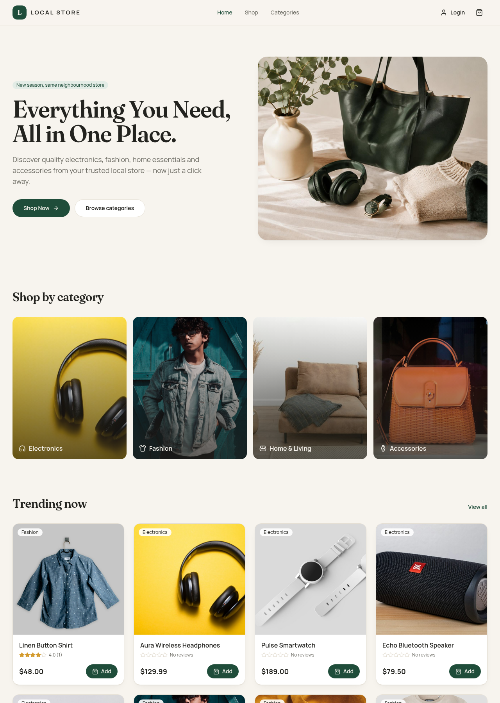
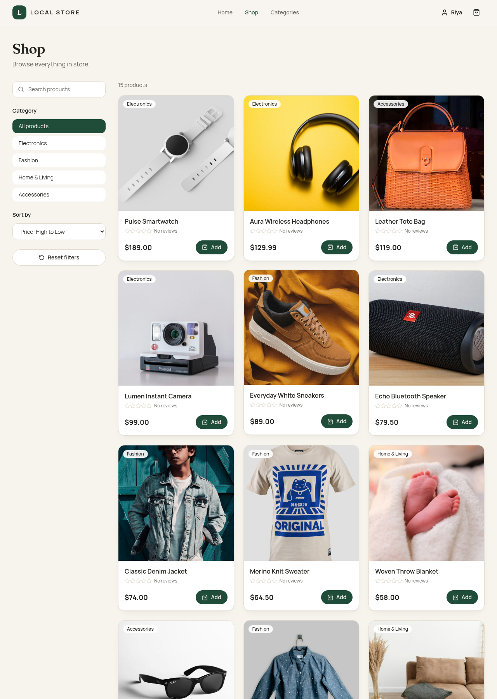
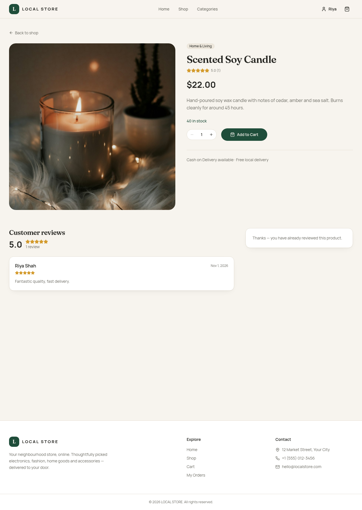
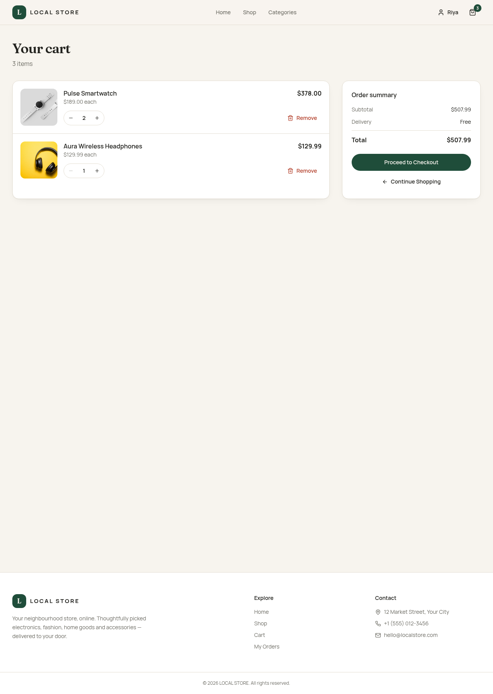
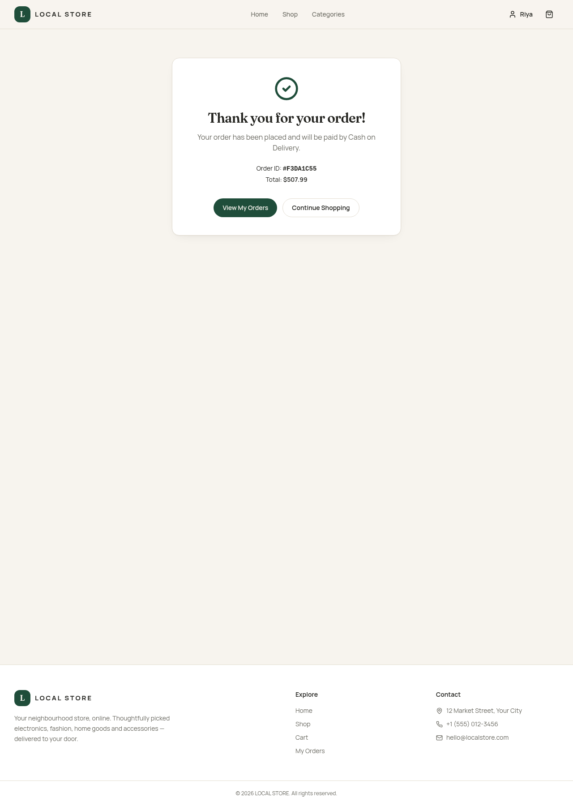
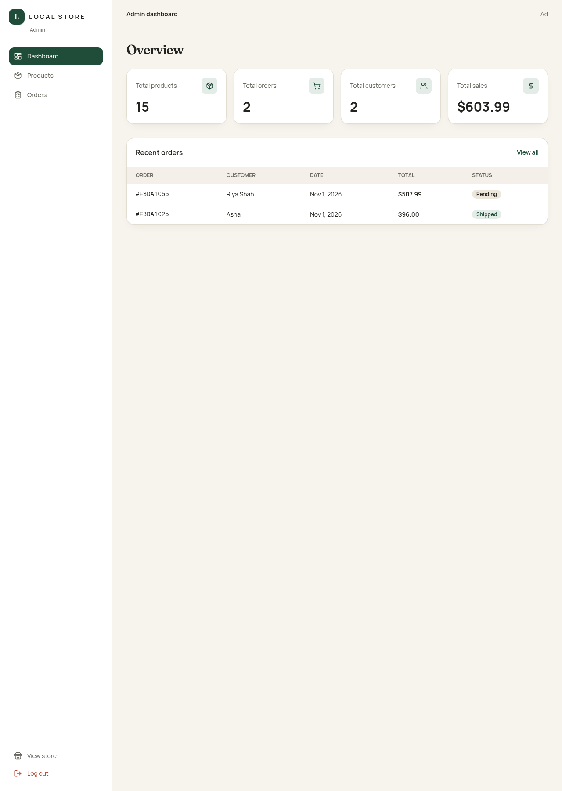

# LOCAL STORE – Full-Stack MERN E-Commerce Platform

LOCAL STORE is a complete e-commerce website for a local retail store, built with the **MERN stack** (MongoDB, Express, React, Node.js) as part of **Prodigy Infotech – Task 03**.

Customers can browse products, search and filter, read and write reviews, manage a cart, and place Cash on Delivery orders. Administrators get a separate dashboard to manage products, stock and orders.

---

## Features

**Customer**
- Home page with hero, featured categories, trending products, promo banner and "Why shop with us"
- Shop page with live search, category filter, price sorting (low→high, high→low) and **Reset filters**
- Product details: large image, description, price, category, stock, quantity selector, average rating and reviews
- Shopping cart: add, remove, increase/decrease quantity, subtotal, total, item count badge, empty state (saved per user in the browser)
- Checkout with validated shipping form and **Cash on Delivery**
- Order confirmation page and **My Orders** history with status
- Register / Login / Logout with JWT, protected routes, profile page

**Admin**
- Sidebar dashboard with stats: total products, orders, customers and sales
- Product management: list, search, filter by category, add, edit, delete, inline stock updates
- Order management: list, filter by status, view details, update status (Pending, Processing, Shipped, Delivered, Cancelled)
- Cancelling an order returns its items to stock

**Optional features (exactly two)**
1. **Product sorting & filtering** – done on the backend via query parameters.
2. **Product reviews & ratings** – logged-in users rate 1–5 stars with a comment; one review per user per product (enforced by a unique MongoDB index); product average rating and review count update automatically.

---

## Technology Stack

| Layer | Tech |
| --- | --- |
| Frontend | React 18, Vite, JavaScript, Tailwind CSS v4, React Router DOM, Axios, Context API, Lucide React |
| Backend | Node.js, Express.js, MongoDB, Mongoose, JWT, bcryptjs |

---

## Folder Structure

```
local-store-ecommerce/
├── frontend/
│   ├── public/
│   ├── src/
│   │   ├── assets/        # hero image
│   │   ├── components/    # Navbar, Footer, ProductCard, Rating, Loader, ...
│   │   ├── pages/         # Home, Shop, ProductDetails, Cart, Checkout, ...
│   │   │   └── admin/     # AdminLayout, Dashboard, AdminProducts, AdminOrders
│   │   ├── context/       # AuthContext, CartContext
│   │   ├── services/      # axios instance + API calls
│   │   ├── hooks/         # useFetch
│   │   ├── utils/         # formatting + constants
│   │   ├── App.jsx
│   │   ├── main.jsx
│   │   └── index.css      # design system (Tailwind theme)
│   ├── package.json
│   └── .env.example
├── backend/
│   ├── config/            # db.js
│   ├── controllers/       # auth, product, order, review, admin
│   ├── middleware/        # protect, adminOnly, error handlers
│   ├── models/            # User, Product, Order, Review
│   ├── routes/
│   ├── utils/             # seed.js, makeAdmin.js, products.json, helpers
│   ├── server.js
│   ├── package.json
│   └── .env.example
├── package.json
├── README.md
└── .gitignore
```

---

## Installation

Requirements: **Node.js 18+** and **MongoDB** (local install or a free MongoDB Atlas cluster).

```bash
git clone <your-repo-url>
cd local-store-ecommerce
npm run install:all
```

## Environment Setup

**backend/.env** (copy from `backend/.env.example`)

```
MONGO_URI=mongodb://127.0.0.1:27017/local-store
JWT_SECRET=a-long-random-secret-string
PORT=5000
CLIENT_URL=http://localhost:5173
```

**frontend/.env** (copy from `frontend/.env.example`)

```
VITE_API_URL=http://localhost:5000/api
```

### MongoDB configuration
- **Local:** install MongoDB Community Server, start it, and use `mongodb://127.0.0.1:27017/local-store`.
- **Atlas:** create a free cluster, add a database user, allow your IP, then paste the connection string, e.g. `mongodb+srv://<user>:<password>@cluster0.xxxxx.mongodb.net/local-store`.

## Seed Sample Products

```bash
npm run seed
```
Inserts 15 products across Electronics, Fashion, Home & Living and Accessories (existing products and reviews are cleared).

## Run the Backend

```bash
npm run dev:backend      # http://localhost:5000
```

## Run the Frontend

```bash
npm run dev:frontend     # http://localhost:5173
```

## Admin Account Setup

For security, registration always creates a **customer**. To create an admin:
1. Register normally in the app (e.g. `admin@localstore.com`).
2. Run:
   ```bash
   npm run make-admin -- admin@localstore.com
   ```
3. Log out and log in again — you will be taken to `/admin`.

---

## API Documentation

Base URL: `http://localhost:5000/api`. Protected routes need `Authorization: Bearer <token>`.

### Auth
| Method | Endpoint | Access | Body |
| --- | --- | --- | --- |
| POST | `/auth/register` | Public | `{ name, email, password }` |
| POST | `/auth/login` | Public | `{ email, password }` |
| GET | `/auth/me` | User | – |

### Products
| Method | Endpoint | Access | Notes |
| --- | --- | --- | --- |
| GET | `/products` | Public | Query: `search`, `category`, `sort=price_asc\|price_desc\|rating\|newest` |
| GET | `/products/:id` | Public | |
| POST | `/products` | Admin | `{ name, description, price, image, category, stock }` |
| PUT | `/products/:id` | Admin | Any of the fields above |
| DELETE | `/products/:id` | Admin | Also deletes its reviews |

### Orders
| Method | Endpoint | Access | Notes |
| --- | --- | --- | --- |
| POST | `/orders` | User | `{ items: [{ productId, quantity }], shippingAddress: { fullName, email, phone, address, city, postalCode } }` – prices taken from DB, stock reduced |
| GET | `/orders/my-orders` | User | |
| GET | `/orders` | Admin | Optional `?status=` |
| PUT | `/orders/:id/status` | Admin | `{ status }` |

### Reviews
| Method | Endpoint | Access | Body |
| --- | --- | --- | --- |
| POST | `/reviews/:productId` | User | `{ rating: 1-5, comment }` (one per user/product, 409 if duplicate) |
| GET | `/reviews/:productId` | Public | |

### Admin
| Method | Endpoint | Access |
| --- | --- | --- |
| GET | `/admin/stats` | Admin – returns `totalProducts, totalOrders, totalCustomers, totalSales, recentOrders` |

Errors are returned as `{ "message": "..." }` with proper status codes (400, 401, 403, 404, 409, 500).

---

## Screenshots

Add your screenshots to a `screenshots/` folder and reference them here:

| Home | Shop | Product |
| --- | --- | --- |
|  |  |  |

| Cart | Checkout | Admin |
| --- | --- | --- |
|  |  |  |

---

© LOCAL STORE – built for Prodigy Infotech Task 03.
